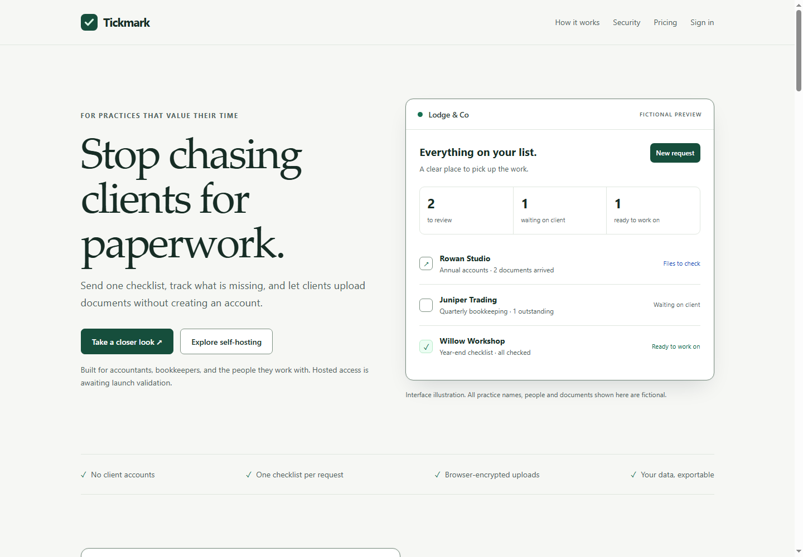
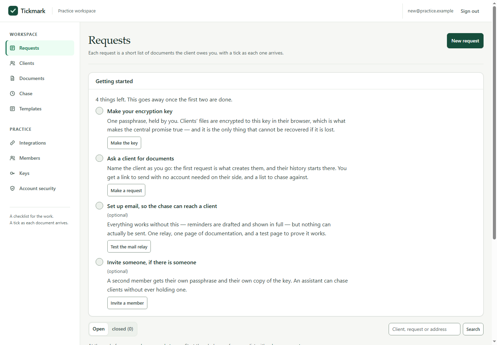
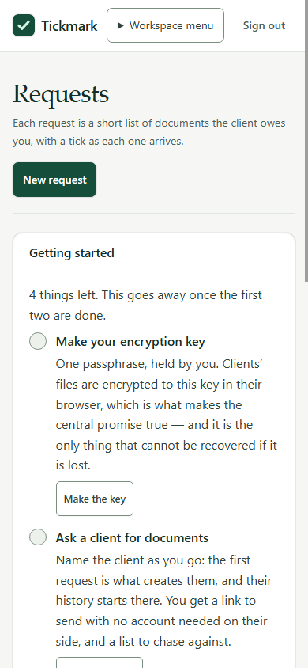
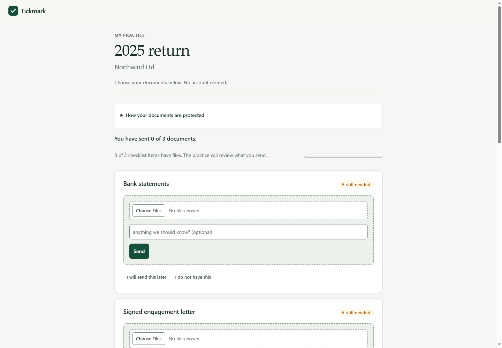
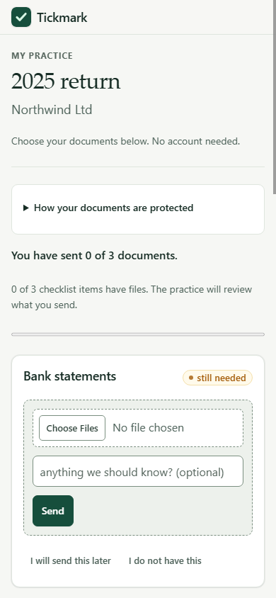
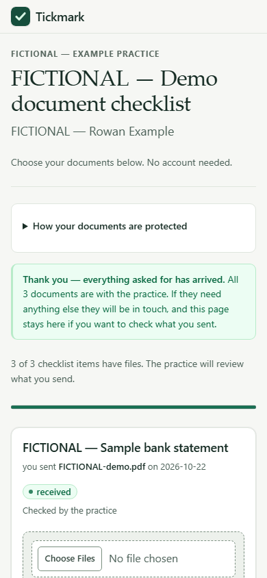

# Independent visual evolution review

## Scope and recommendation

- Compared `codex/tickmark-visual-evolution` at `36a697bcdc9c8ccc000474a9ba47aa7121db9acc` with `main` at `dca09fe8ec027f17e8f45e45214caefa048676e3`.
- Review fixes and this report are on `codex/tickmark-visual-review`, based on Sol's branch. No merge or deployment was performed.
- Recommendation: the redesign is visually acceptable at the sampled 1440px and 390px viewports. Carry the review branch's one-line asset fix with the redesign: the client upload module otherwise fails to load. No further visual polish is required from this pass. Coverage remains under the configured gates, so any integration policy requiring green coverage should hold on that existing gap.

## Findings

### Fixed: client upload module import returned 404

This was present in the reviewed branch and in `main`; it was not introduced by the visual redesign. `web/upload.js` imports `./preflight.js`, but the server's `ASSETS` allowlist omitted `preflight.js`. In a real Edge page, `/assets/upload.js` and `/assets/tickmark-crypto.js` returned 200 while `/assets/preflight.js` returned 404. The module therefore never registered its submit handler, and selecting Send fell through to the server's raw-upload refusal.

Added `preflight.js` to the application asset allowlist and added a regression to `test/assets.test.js`. The regression failed before the fix with `404 !== 200` and passes afterward. A synthetic browser upload then completed through the browser encryption module and returned to the client checklist with the filename shown and the submission marked as awaiting practice review. The latest stored blob did not contain the synthetic PDF's plaintext marker.

No other confirmed regression was found in the changed renderers, page shell, stylesheet, marketing builder, navigation, gateway forms, billing views or client checklist.

## Visual review

Microsoft Edge was used with DevTools device emulation set to 1440×1000 and 390×844 CSS pixels. Marketing and application screens were rendered from the repository's static marketing page and its captured HTTP-rendered synthetic app pages. These screenshots are real browser renderings; the hosted signup, dashboard and initial client checklist screenshots are visual fixtures, not authenticated hosted sessions. The upload receipt screenshot is from the live local synthetic app.

At the checked sizes, the marketing hero stacks cleanly on mobile, signup fields remain within the page, the practice workspace menu and sign-out fit in the mobile header, and checklist cards and file controls fit the client page. The measured mobile document width was 390px for each sampled page; no horizontal page overflow was found. Dense practice tables still use their intended scroll regions.

| Screen | Desktop | Mobile |
| --- | --- | --- |
| Marketing |  |  |
| Hosted signup |  |  |
| Practice dashboard |  |  |
| Client checklist |  |  |

Synthetic browser upload and receipt:

The file picker selected `FICTIONAL-browser-review.pdf` generated for this disposable run. Edge loaded the upload and preflight modules from the local app, submitted the file, and displayed the receipt plus “Awaiting review by the practice.” The stored encrypted blob did not contain the PDF body marker. No real client information or external service was used.

## Authentication, billing, isolation and data custody

The visual branch keeps existing field names, form actions, route and role checks, cookie issuance, TOTP challenge handling, billing states, and encrypted-upload selectors. The full application suite passes, including hosted login and signup, second-factor and recovery flows, tenant membership/isolation, subscription and webhook transitions, client-link suspension, file encryption/decryption, and self-hosted request workflows.

The marketing-origin configuration accepts only an HTTPS origin. It rejects credentials, paths, queries and fragments, and the generated sign-in URL is the app origin plus `/login`. The application-to-marketing link is only the configured origin, carries `rel="noreferrer"`, and application responses set `Referrer-Policy: no-referrer`. Session and challenge cookies remain host-only (no `Domain` attribute), so the browser does not send them to the separate marketing host. The standalone marketing page has no scripts, forms, cookies or automatic third-party resource requests. No bearer token, client URL, cookie or authentication value is added to a marketing URL.

These conclusions come from source inspection, existing security tests and the local synthetic run; they do not establish the security of a future DNS, reverse-proxy, browser-extension or hosting configuration.

## Verification

- `npm test`: **563 passed, 0 failed**.
- `npm run coverage`: **91.56% lines / 74.60% branches / 88.86% functions**; it exits nonzero against the unchanged **93% / 75% / 90%** thresholds.
- `npm run check:site`, `check:docs`, `check:style`, `check:nav`, `find:unused`, `snapshot`, `check:pages`, `check:gateway`, and `git diff --check`: pass. Snapshots cover 42 application pages; gateway checks cover 14 states; 514 exports, zero unused.
- `node --test test/assets.test.js`: 4 passed, including the new preflight route regression.
- `npm run build:site -- tmp-review-marketing`: succeeds. Existing tests also exercise configured app/marketing origins and reject unsafe origin forms.
- Real browser: Edge desktop/mobile screenshots captured for the four requested surfaces; one local synthetic upload reached receipt and pending-review state.
- Container check: not verified. Docker CLI is installed, but Docker Engine is unavailable (`dockerDesktopLinuxEngine` named pipe does not exist). `check:container` did not build or run an image; its default probe hit an unrelated local port-3000 server returning 500 and stopped.

## Integration boundary

The UI review did not exercise real hosted accounts, payment processing, provider callbacks, tenant DNS, production cookies behind a TLS proxy, production backup storage, or support/offboarding operations. The screenshots use fictional data. No production readiness or paid-launch claim follows from this review. Preserve the existing coverage thresholds and close the reported coverage shortfall through meaningful tests before declaring the quality gates green.
